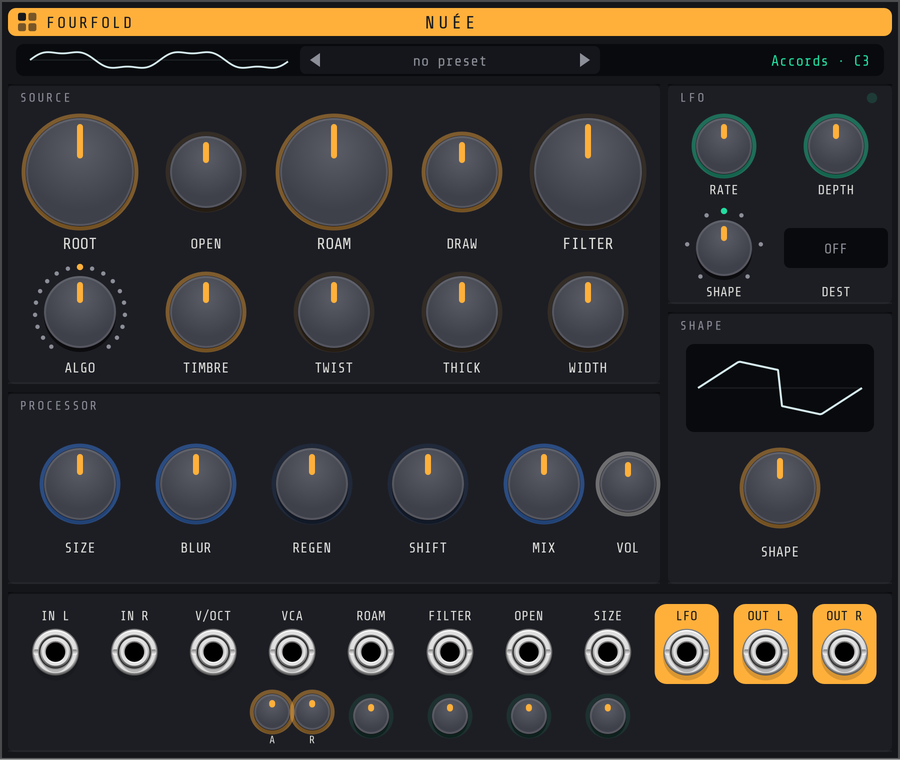
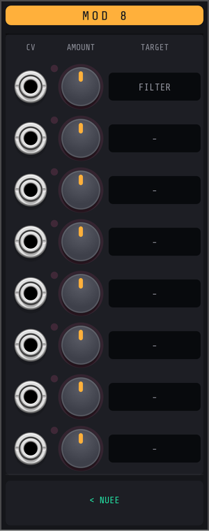

# Fourfold Nuée — manual

- [Nuée](#nuee)
  - [Top display and presets](#top-display-and-presets)
  - [SOURCE](#source)
  - [Algorithms](#algorithms)
  - [PROCESSOR](#processor)
  - [LFO](#lfo)
  - [SHAPE](#shape)
  - [Inputs and outputs](#inputs-and-outputs)
- [MOD 8](#mod-8)

Every knob has a tooltip in Rack. For TIMBRE, TWIST, OPEN, ROAM and SHAPE, the tooltip follows the algorithm playing.

## Nuée

A stereo drone voice: a sound source chosen among 19 algorithms, then a space (delays, diffusion, feedback,
frequency shifter). It plays as soon as it is in the patch, with no gate.

### Top display and presets
- Left: an oscilloscope of the output.
- Middle: the preset bar. Click the name to open the list (your presets, then the factory presets; the loaded one is
  checked). The arrows step to the previous / next preset. A `*` after the name means a knob was changed since loading.
  The list also offers **Save over** (rewrites the loaded preset) and **Save as new in** (pick a category, type a
  name, press Enter). Loading a preset can be undone with Ctrl+Z.
- Right: the algorithm, the note played, and the LFO destination.

71 factory presets in 5 categories: Bass, Drone, Grit, Metal, Texture.

### SOURCE
| Knob | What it does |
|---|---|
| ROOT | Base note, C0 to C8. The V/OCT input adds 1 V per octave. |
| OPEN | Spreads the voices (over the scale, or freely, depending on the algorithm). Unison at noon in the chord algorithms. |
| ROAM | Travels between 8 chords or snapshots of the algorithm. |
| DRAW | Picks at random where pitches and delays fall. |
| FILTER | DJ filter: low-pass to the left, high-pass to the right, open at noon. |
| ALGO | Chooses one of the 19 algorithms (also in the right-click menu). Changing algorithm crossfades. |
| TIMBRE | The main colour control of the algorithm (waveform, resonance, formant, folding…). |
| TWIST | Usually: left = phase modulation, right = FM or folding. |
| THICK | Usually: left = chorus, right = saturation. Nothing at noon. |
| WIDTH | Stereo: places the voices and spreads the L/R delays. Noon: as designed. |

### Algorithms
| # | Name | In short |
|---|---|---|
| 1 | Accords | Chords of 8 voices with selectable waveforms |
| 2 | Résonance | Noise through 8 tuned resonant filters |
| 3 | Pulsar | Pulsar trains with a moving formant |
| 4 | Pli | Folded oscillators with 2 gliding notches |
| 5 | Grappe | Clusters of 8 waveforms |
| 6 | Libre | Free spread of voices, up to 10 octaves |
| 7 | Mineur | Voices on the minor scale |
| 8 | Rouille | A scanned waveform with bit reduction |
| 9 | Anneau | 8 sines with ring modulation |
| 10 | Lecture | A waveform read by a moving reading point |
| 11 | Duo | Carrier and modulator pair |
| 12 | Ombre | Drawn waveforms |
| 13 | Phase | A minor chord through phaser notches |
| 14 | Grains | Grains with formants |
| 15 | Peignes | Noise through combs and resonators |
| 16 | Brûlure | Biased, folded and bumped oscillators |
| 17 | Couples | Sine pairs through allpass dispersion |
| 18 | Partiels | Additive partials, harmonic to inharmonic |
| 19 | Essaim | A swarm of voices |

### PROCESSOR
| Knob | What it does |
|---|---|
| SIZE | Size of the space (scale of the delays). |
| BLUR | From a clean echo to a diffuse space. |
| REGEN | Feedback: negative to the left, positive to the right, none at noon. |
| SHIFT | Frequency shift, up to a few hundred Hz each way. None at noon. |
| MIX | Dry / processed. |
| VOL | Output level. |

### LFO
- **RATE**: 0.01 Hz to 20 Hz. **DEPTH**: amount sent to the destination.
- **SHAPE** (small knob): sine, triangle, ramp, square, random (steps), random (smooth).
- **DEST**: click the screen, it shows *click a knob*; then click the knob to modulate. Click the screen again to
  cancel. Right-click it to remove the destination (*OFF*). Both can be undone with Ctrl+Z. The destination can also
  be picked in the right-click menu (*LFO target*). The knob itself does not move; its ring shows the modulation.
- The LFO is also sent to the **LFO** output (±5 V).

### SHAPE
The large SHAPE knob changes what the algorithm is made of: a wave palette, the family of the oscillator waveforms
(sine, triangle, saw, square), the shape of the grains, or the colour of the noise, depending on the algorithm.
Fully left gives the original sound. The screen above it draws what SHAPE does in the algorithm playing.

### Inputs and outputs
| Jack | What it does |
|---|---|
| IN L / IN R | Audio into the space (the PROCESSOR). IN L alone is also sent right. |
| V/OCT | 1 V per octave, added to ROOT. |
| VCA | Output level: 0 V silent, fully open from +5 V; unplugged = open. The two small knobs **A** and **R** below set the attack and release (2 ms to 4.5 s): a gate on VCA becomes an envelope. The space keeps ringing after the VCA closes. |
| ROAM, FILTER, OPEN, SIZE | CV inputs, each with an attenuverter below (cubic response, −100 % to +100 %). An empty ROAM jack receives the VCA jack; an empty FILTER, OPEN or SIZE jack receives the ROAM jack, or else the VCA jack. |
| LFO | The LFO, ±5 V. |
| OUT L / OUT R | Stereo audio output. |

## MOD 8

A modulation expander for Nuée: 8 CV inputs, each one modulating a knob of your choice.

- Place MOD 8 **directly to the right** of a Nuée. The bottom line shows `< NUEE` when it is attached.
- **TARGET**: click a box, it shows *click a knob*; then click a knob on Nuée. Click the box again to cancel.
  Right-click it to free the input. Both can be undone with Ctrl+Z. Stepped knobs (ALGO, LFO shape) cannot be targeted.
- **AMOUNT**: −100 % to +100 %, 0 % by default (double-click returns to 0 %). At 100 %, ±5 V moves the target by ±
  half of its range. The knob on Nuée does not move.
- MOD 8 is read about 1,500 times per second: made for LFOs, envelopes and slow CV, not for audio-rate modulation.

## Known limit
Above 384 kHz, the Partiels algorithm may go silent. Every other algorithm keeps playing.
