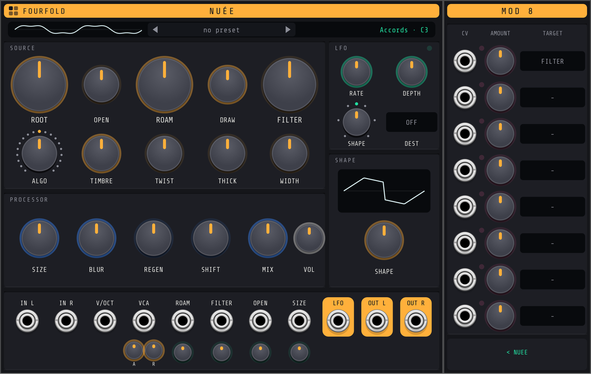

# Fourfold Nuée

Free modules for [VCV Rack 2](https://vcvrack.com), by Fourfold.

- **Nuée** — a stereo drone voice: 19 algorithms (modal chords, resonators, pulsars, folded sines, wavetable clusters,
  combs, partials, swarms…) feeding a built-in space, with an LFO, CV inputs with attenuverters, a VCA with attack and
  release, and an audio input into the space. 71 factory presets.
- **MOD 8** — Nuée's modulation expander: 8 CV inputs, each assigned to a knob of the Nuée on its left.

**[Read the manual](MANUAL.md)**

## Install
From the [VCV Library](https://library.vcvrack.com): add the plugin to your account, then open Rack and let it sync.

## Bugs and questions
Open an issue in this repository.

## License
Freeware: free to use, including for commercial music. The plugin is closed source. See [LICENSE.txt](LICENSE.txt).
